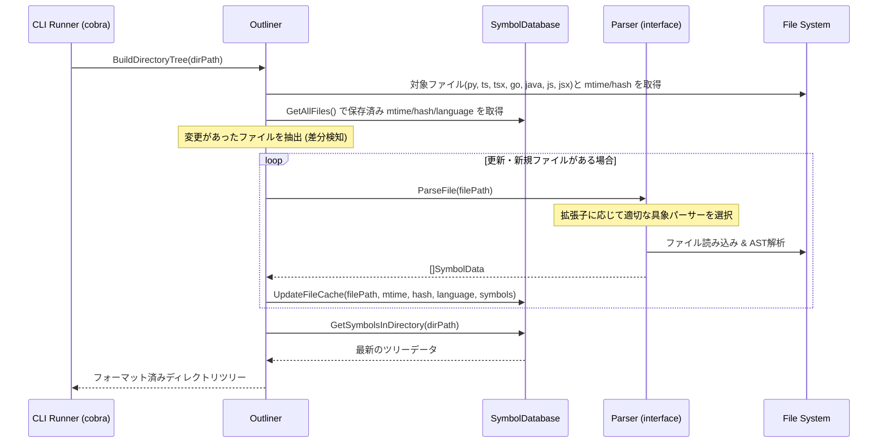
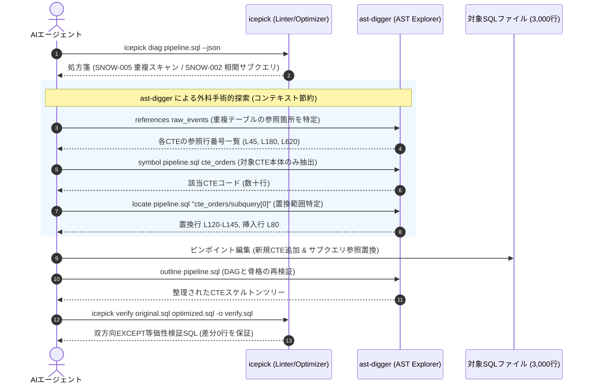
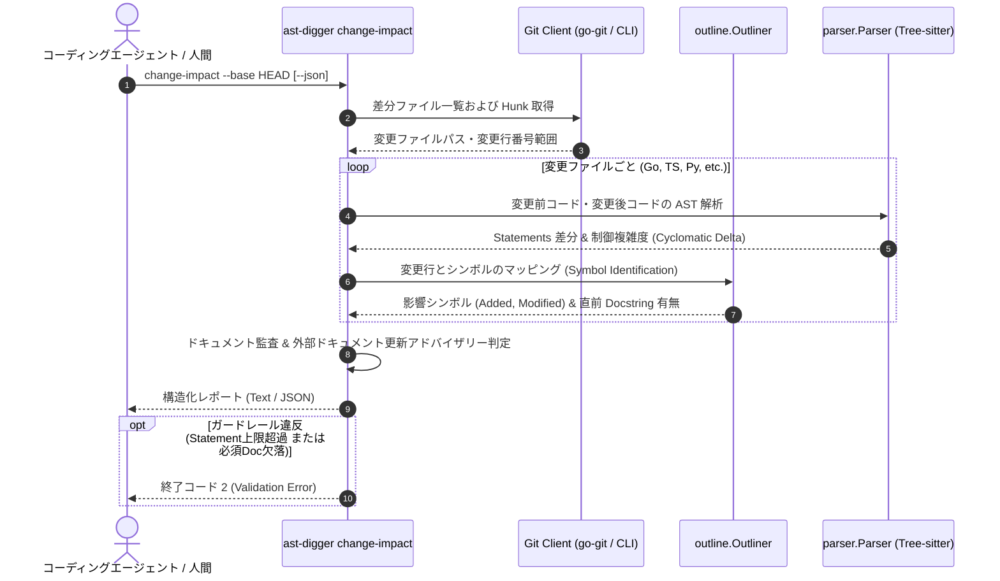

# AST-Digger 設計書 (design.md)

## 目次
- [機能一覧](#機能一覧)
- [機能詳細](#機能詳細)
- [アーキテクチャ](#アーキテクチャ)
  - [設計方針](#設計方針)
  - [全体構成図](#全体構成図)
  - [レイヤー構造](#レイヤー構造)
  - [全体シーケンス図](#全体シーケンス図)
- [インターフェース](#インターフェース)
  - [CLI インターフェース](#cli-インターフェース)
  - [キャッシュデータモデル](#キャッシュデータモデル)
- [コンポーネント](#コンポーネント)
  - [クラス図概要](#クラス図概要)
  - [主要コンポーネント設計](#主要コンポーネント設計)
- [エラーハンドリング](#エラーハンドリング)

---

## 機能一覧

| 機能カテゴリ | 機能ID | 機能名 | 概要 | 対応要件ID |
|:------------|:-------|:------|:-----|:----------|
| アウトライン抽出 | F-1 | ファイルアウトライン生成 | 指定されたファイル(Python/TS/Go/Java/JavaScript/Rust)の構文解析を行い、クラス/関数/構造体/インターフェース/enum/impl/traitのスケルトンコードを生成する。 | 要件 A-1 |
| ピンポイント抽出 | F-2 | シンボルコード抽出 | 指定されたシンボルの実装コードをASTからピンポイントで抽出する。 | 要件 B-1 |
| 参照・依存探索 | F-3 | シンボル参照探索 (Callers) | プロジェクト全体から、指定されたシンボル名が呼び出されている箇所を構文レベルで探索する。 | 要件 C-1 |
| 参照・依存探索 | F-4 | 依存インポート解決 (Callees) | 指定したファイル内でインポートされているシンボルの定義元ファイルパスと開始行を解決する。 | 要件 D-1 |
| ディレクトリツリー | F-5 | ディレクトリ構造化アウトライン出力 | SQLiteキャッシュを用いて、更新ファイルのみを差分スキャンし、シンボル情報付きのディレクトリツリーを生成する。 | 要件 E-1 |
| 自己内省・運用 | F-6 | エージェント用コンテキスト出力 | エージェントがツールの全機能を自動認識できるように、スキーマ定義をJSON形式で出力する。 | 要件 F-1, H-1 |
| 自己内省・運用 | F-7 | フリクションフィードバック記録 | エージェントが実行中に遭遇した不具合や摩擦をローカルファイルにログ出力する。 | 要件 F-2 |
| 自己内省・運用 | F-8 | シンボル位置特定 | 指定したシンボルの定義位置のみを軽量に取得する。 | 要件 G-1 |
| 運用品質 | F-9 | 大規模出力の上限制御 | `references` の `--limit`、`outline`/`symbol` の自動切り詰めと `--no-truncate`。 | 要件 H-2 |
| 運用品質 | F-10 | エラー候補提示 | シンボル未検出時に、実在するシンボル名候補をエラーメッセージに含める。 | 要件 H-3 |
| 運用品質 | F-11 | 終了コードタクソノミー | エラー種別ごとに一貫した終了コードを定義・適用する。 | 要件 H-4 |
| 運用品質 | F-12 | 単一バイナリ配布 | CGO依存を許容し、各プラットフォーム上のネイティブビルドで生成する。 | 要件 I-1 |
| バックログ機能 | F-13 | 対応言語・拡張子一覧提示 (将来機能) | `agent-context` JSONメタデータに `supported_languages` / `supported_extensions` を追加。 | 要件 J-1 |
| バックログ機能 | F-14 | 依存コード自動追跡 (将来機能) | `symbol` に `--follow-imports` オプションを追加し、依存先コード本文を一括抽出・返却する。 | 要件 J-2 |
| ドキュメント解析 | F-15 | Markdownドキュメント構造解析 | `tree-sitter-markdown` を用いて見出し階層（H1〜H6）とコードブロック（Mermaid等）をパースし、スケルトン・ピンポイント抽出・セクション特定を行う。 | 要件 K-1, K-2, K-3 |
| SQL構造解析 | F-16 | SQL/CTEアウトライン・データフロースケルトン生成 | `tree-sitter-sql` を用いてSnowflake/標準SQLのCTE（WITH句）、DAG依存関係（depends_on）、メインステートメントをパースし、軽量スケルトンを生成する。 | 要件 L-1 |
| SQL構造解析 | F-17 | サブクエリ添字抽出とCTE依存追跡 | `subquery[0]` による名前なしサブクエリの特定・抽出、および `--follow-imports` による上流CTE依存コードの一括抽出を行う。 | 要件 L-2, L-3, L-4 |
| SQL構造解析 | F-18 | Icepick連携最適化リファクタリング探索 | `icepick` の診断結果（SNOW-002, SNOW-005, SNOW-007等）に基づく重複スキャン集約、相関サブクエリJOIN化、CTE外出しのピンポイント外科手術的探索を行う。 | 要件 L-5, L-6 |
| SQL構造解析 | F-19 | ビュー定義（CREATE VIEW）認識と警告抑止 | `CREATE [OR REPLACE] [SECURE | MATERIALIZED] VIEW` や `CREATE DYNAMIC TABLE` から名称を抽出してシンボル登録し、同一ファイルの警告連打を抑止する。 | 要件 L-7 |
| 変更インパクト解析 | F-20 | 意味的変更インパクト解析と意図・ドキュメント充足度評価 | Git差分とAST解析を組み合わせ、構文ステートメント増分、制御複雑度、シンボルDocstring充足度、外部ドキュメント同期アドバイザリーを構造化出力する。 | 要件 M-1, M-2, M-3, M-4 |


---

## 機能詳細

### 機能カテゴリ1: アウトライン抽出
- **F-1: ファイルアウトライン生成**
  - **概要**: 対象のソースコードファイル（Python/TypeScript/Go/Java/JavaScript）をパースし、クラスや関数、構造体、インターフェース、enumの定義シグネチャとdocstring/コメントだけを抽出して実装部分を省略したスケルトンを出力する。
  - **対応要件**: 要件 A-1
  - **設計のポイント**:
    - **Python対象コード**: tree-sitter-python文法で `class_definition` / `function_definition` 等を巡回し、関数ボディの `block` ノードを `...` に置換。docstring・デコレータは保持。
    - **TypeScript対象コード**: tree-sitter-typescript文法で `class_declaration` / `interface_declaration` / `type_alias_declaration` / `function_declaration` / `method_definition` を検出し、ボディを `{ /* ... */ }` に置換。JSDocは保持。
    - **Go対象コード**: tree-sitter-go文法で `type_declaration`（struct/interface）/ `function_declaration` / `method_declaration` を検出し、ボディを `{ /* ... */ }` に置換。doc commentsは保持。
    - **Java対象コード**: tree-sitter-java文法で `class_declaration` / `interface_declaration` / `enum_declaration` / `method_declaration` / `constructor_declaration` を検出し、メソッド/コンストラクタのボディ（`block`）を `{ /* ... */ }` に置換。直前に隣接する `/** ... */` 形式の `block_comment`（Javadoc）をdocstringとして保持。`modifiers` ノード（`public`/`private`/`static`/アノテーション等）はシグネチャの一部として保持する。フィールド宣言（`field_declaration`）はPython/TypeScript/Goの既存シンボル体系（クラス/関数/メソッド/インターフェース/構造体/型のみを`SymbolData`化し、プロパティ単体は対象外とする方針）との一貫性を保つため、シンボルとして個別抽出しない。コンストラクタは`kind`を`"method"`として扱い、専用の`kind`値は設けない。
    - **JavaScript対象コード**: tree-sitter-javascript文法（JSX含む）で `class_declaration` / `function_declaration` / `method_definition` / `arrow_function`（`variable_declarator`の初期化子として出現するものを対象）を検出し、ボディを `{ /* ... */ }` に置換。直前の `/** ... */` 形式の `comment`（JSDoc）は保持。tree-sitter-javascriptはtree-sitter-typescriptの基盤文法であり主要ノード種別（`class_declaration`/`function_declaration`/`method_definition`/`import_statement`等）は共通のため、`TypeScriptParser`と同様のノード走査ロジックを型注釈を持たない形で流用する。

### 機能カテゴリ2: ピンポイント抽出
- **F-2: シンボルコード抽出**
  - **概要**: 指定されたシンボルの実装コードのみを切り出す。
  - **対応要件**: 要件 B-1
  - **設計のポイント**: `symbolPath` をドットで分割し、対応するASTノードを探索する。Go対象コードの場合、メソッドはレシーバ型（例: `(h *Handler)`）をパースして構造体名と一致するものを特定する。Java対象コードの場合、`ClassName.methodName` を `class_declaration`/`enum_declaration`配下の`method_declaration`/`constructor_declaration`とオーバーロード名（同名メソッドが複数存在する場合は最初に一致したもの）で照合する。JavaScript対象コードの場合、クラスメソッドは`ClassName.methodName`（`method_definition`）、トップレベル関数・アロー関数は単一名（`function_declaration`または`variable_declarator`の識別子名）で照合する。

### 機能カテゴリ3: 参照・依存探索
- **F-3: シンボル参照探索 (Callers)**
  - **概要**: 指定されたシンボル名がプロジェクト内のどこで呼び出されているかを探索する。
  - **対応要件**: 要件 C-1
  - **設計のポイント**: ファイル走査時にまず文字列一致で高速フィルタリングし、ヒットしたファイルのみをtree-sitterでパースする。`--project-root` で探索範囲を制御する。

- **F-4: 依存インポート解決 (Callees)**
  - **概要**: 指定したファイルがインポートしているローカルモジュールのシンボルの定義先ファイルを特定する。
  - **対応要件**: 要件 D-1
  - **設計のポイント**: Go対象コードの場合、`import_spec` を解析し、`go.mod` のあるディレクトリを起点にパッケージパスからローカルディレクトリを解決する。
    - **Java対象コード**: `import_declaration` を解析し、完全修飾名（例: `com.example.service.UserService`）をパッケージ区切り（`.`）でディレクトリ階層に変換し、`--project-root`配下のソースルート（`src/main/java`等の慣習パスを優先探索し、見つからない場合は`--project-root`直下）を起点に`<パッケージパス>/<ClassName>.java`を解決する。ワイルドカードインポート（`import com.example.*;`）の場合はパッケージディレクトリ配下を走査し、シンボル名と一致するトップレベルクラス/インターフェース/enumを含む`.java`ファイルを特定する。
    - **JavaScript対象コード**: `import_statement`の`source`フィールド（モジュール指定子文字列）を相対パス解決する。既存`TypeScriptParser.ResolveImports`の相対パス解決ロジック（`fileDir`起点、拡張子補完、`index`ファイルへのフォールバック）を流用しつつ、拡張子補完の優先順位を`.js`/`.jsx`（TypeScriptParserは`.ts`/`.tsx`優先）に変更する。

### 機能カテゴリ4: ディレクトリツリー
- **F-5: ディレクトリ構造化アウトライン出力**
  - **概要**: SQLiteキャッシュを用いて差分パースし、シンボル情報付きのディレクトリ階層ツリーを生成する。
  - **対応要件**: 要件 E-1
  - **設計のポイント**:
    - キャッシュDBは `.workspace_cache/symbols.db` とする。
    - `mtime` とコンテンツの `SHA-256ハッシュ` による差分判定により不要な再パースを防ぐ。
    - スキャン対象拡張子: `.py`, `.ts`, `.tsx`, `.go`, `.java`, `.js`, `.jsx`。

### 機能カテゴリ5: 自己内省・運用
- **F-6: エージェント用コンテキスト出力 (agent-context)**
  - **概要**: 全サブコマンド・全オプションのスキーマをJSONで出力する。スキーマの更新漏れを防ぐため、**cobraのコマンド定義から動的にスキーマを導出する**方式を採用する。
  - **対応要件**: 要件 F-1, H-1
  - **設計のポイント**: cobraの `*cobra.Command` ツリー（`Use`, `Flags()`, `LocalFlags()` 等）を走査し、JSONスキーマを組み立てる。
- **F-7: フリクションフィードバック記録 (feedback)**
  - **概要**: 実行時の問題を、`.workspace_cache/feedback.jsonl` にタイムスタンプ付きで追記する。
  - **対応要件**: 要件 F-2
- **F-8: シンボル位置特定 (locate)**
  - **概要**: 指定したシンボルの定義位置（ファイルパス、開始行、終了行）のみを軽量に取得する。
  - **対応要件**: 要件 G-1

### 機能カテゴリ6: 運用品質
- **F-9: 大規模出力の上限制御**
  - **概要**: `references` に `--limit`、`outline`/`symbol` に閾値（デフォルト300行）超過時の自動切り詰めと `truncated` フラグ、解除用の `--no-truncate` を提供する。
  - **対応要件**: 要件 H-2
- **F-10: エラー候補提示**
  - **概要**: `symbol`/`locate` でシンボル未検出時、`ParseFile` 結果から実在するシンボル名候補（上位5件）をエラーメッセージに含める。
  - **対応要件**: 要件 H-3
- **F-11: 終了コードタクソノミー**
  - **概要**: エラー種別ごとに一貫した終了コードを定義する。詳細は本書「[エラーハンドリング](#エラーハンドリング)」を参照。
  - **対応要件**: 要件 H-4

### 機能カテゴリ7: ビルド・配布
- **F-12: シングルバイナリビルド（ネイティブビルドのみ）**
  - **概要**: `go build ./cmd/ast-digger` で、ビルドを実行したプラットフォーム向けの単一実行ファイルを生成する。tree-sitterバインディングのCGO依存により、リンク時の静的リンク設定が必要。
  - **対応要件**: 要件 I-1

---

## アーキテクチャ

### 設計方針

- **LLM Context-Aware Design**: エージェントに長大なコードファイルを読ませず、アウトラインやピンポイントの実装コードに絞り込むことでトークンを節約する。
- **Incremental Cache with SQLite**: `mtime` + SHA-256ハッシュによる差分スキャンで、SQLite内のシンボル情報を高速に同期・維持する。
- **Interface-Driven Parser Architecture**: 解析エンジンの基本構造を抽象化する `parser.Parser` インターフェースを `internal/parser/base.go` に定義し、言語ごとの実装（`PythonParser`, `TypeScriptParser`, `GolangParser`）を具象型としてカプセル化する。新しい言語の追加は `Parser` インターフェースを満たす新規具象型を追加するだけで完結させる。
- **CGO境界の隔離**: tree-sitterバインディングへの依存（CGO）は `internal/parser` パッケージ内に閉じ込め、`internal/db`（Pure Go SQLiteドライバ使用）や `internal/outline`、`cmd/ast-digger` からは直接のCGO依存が漏れ出さない構成とする。
- **スキーマ・ドリフトの構造的防止**: スキーマと実装の乖離を防ぐため、cobraのコマンド定義からスキーマを動的生成する方式を採用する。

### 全体構成図

```mermaid
graph TD
    subgraph cli["CLI / Interface"]
        A["CLI Runner: cmd/ast-digger/main.go (cobra)"] --> B["Outliner: internal/outline"]
    end
    subgraph parsing["Parsing Engine (internal/parser, CGO境界)"]
        B --> C["Parser interface: parser/base.go"]
        C --> C2["PythonParser: parser/python.go"]
        C --> C3["TypeScriptParser: parser/typescript.go"]
        C --> C4["GolangParser: parser/golang.go"]
        C --> C5["JavaParser: parser/java.go"]
        C --> C6["JavaScriptParser: parser/javascript.go"]
        C --> C7["RustParser: parser/rust.go"]
        C --> C8["MarkdownParser: parser/markdown.go"]
        C2 --> D2["go-tree-sitter + tree-sitter-python"]
        C3 --> D3["go-tree-sitter + tree-sitter-typescript"]
        C4 --> D4["go-tree-sitter + tree-sitter-go"]
        C5 --> D5["go-tree-sitter + tree-sitter-java"]
        C6 --> D6["go-tree-sitter + tree-sitter-javascript"]
        C7 --> D7["go-tree-sitter + tree-sitter-rust"]
        C8 --> D8["go-tree-sitter + tree-sitter-markdown"]
    end
    subgraph cache["Cache Layer (internal/db, Pure Go)"]
        B --> E["SymbolDatabase: db/db.go"]
        E --> F[("SQLite: symbols.db")]
    end
    subgraph target["Target Codebase"]
        C2 --> G2["Target Python Files"]
        C3 --> G3["Target TS/TSX Files"]
        C4 --> G4["Target Go Files"]
        C5 --> G5["Target Java Files"]
        C6 --> G6["Target JS/JSX Files"]
        C7 --> G7["Target Rust Files"]
        C8 --> G8["Target Markdown Files"]
    end
```




- **CLI Runner**: cobraでサブコマンド・フラグを定義し、パース結果を `Outliner` に橋渡しする。
- **Outliner**: スケルトンコードの再構成、SQLiteキャッシュとパース結果を結合したディレクトリツリー生成、`agent-context`/`feedback`/`locate` のオーケストレーションを担う（Python版 `Outliner` クラスに相当）。
- **Parser interface / 各具象パーサー**: 各ターゲット言語に対応するtree-sitterベースのAST解析。
- **SymbolDatabase**: SQLiteによるファイル更新履歴・シンボル情報の永続化。

### レイヤー構造

- **Presentation Layer** (`cmd/ast-digger/main.go`): CLIコマンド・フラグ定義、標準出力/JSON出力の提示。
- **Domain Layer** (`internal/parser/`, `internal/outline/`): ASTパース、シンボル絞り込み、スケルトン組み立てなど、コアロジックを担う。
- **Data Access Layer** (`internal/db/`): SQLite接続、インデックスの追加・更新・削除、差分検知ロジック。
- **Error Layer** (`internal/apperr/`): カスタムエラー型と終了コードのマッピングを一元管理する。

### 全体シーケンス図

以下は `directory` サブコマンド（キャッシュ付きディレクトリツリー出力）実行時のシーケンス。



---

## インターフェース

### CLI インターフェース

本ツールは `ast-digger` コマンドに対し、サブコマンド形式で機能を呼び出す構成とする。

#### ベースコマンド
- **コマンド名**: `ast-digger`
- **共通パラメータ**:
  - `-j, --json`: 構造化されたJSON形式で出力（ブールフラグ）。

#### サブコマンド一覧

##### サブコマンド1: `outline`
- **使用例**: `ast-digger outline <file_path> [--json] [--no-truncate]`
- **入力**: `file_path`（string, 必須）
- **処理概要**: 対象ファイル（`.py`/`.ts`/`.tsx`/`.go`/`.java`/`.js`/`.jsx`）をパースし、クラス・関数・構造体・インターフェース・enum等の定義シグネチャ・docstring/doc commentのみを抽出したスケルトンを生成する。テキスト出力は300行を超えると自動的に切り詰められる（`--no-truncate`で無効化可能。`--json`出力は常に無切り詰め）。
- **出力**: 実装ボディが`...`または`{ /* ... */ }`に置換されたスケルトンコード文字列（テキスト）、または`--json`指定時はシンボル構造データの配列。

##### サブコマンド2: `symbol`
- **使用例**: `ast-digger symbol <file_path> <symbol_path> [--json] [--no-truncate]`
- **入力**: `file_path`（string, 必須）, `symbol_path`（string, 必須 — 例: `MyClass.my_method`、Goの場合は`ReceiverType.MethodName`、Javaの場合は`ClassName.methodName`、JavaScriptの場合は`ClassName.methodName`（クラスメソッド）または`functionName`（トップレベル関数/アロー関数））
- **処理概要**: 指定されたシンボルの実装コードを切り出して取得する。抽出コードが300行を超える場合はテキスト・JSONいずれの出力でも自動的に切り詰められる（`--no-truncate`で無効化可能）。シンボルが見つからない場合、既存シンボル名との類似度（Ratcliff/Obershelpアルゴリズム、上位5件）に基づく候補を終了コード4とともに提示する（要件H-3）。
- **出力**: 該当シンボルの実装コード文字列（`--json`指定時は、名前・種類・親・ファイルパス・開始/終了行・シグネチャ・docstring・コードを含む構造化JSON。切り詰め発生時は`truncated`/`total_lines`/`limit_lines`/`message`を追加）。

##### サブコマンド3: `references`
- **使用例**: `ast-digger references <symbol_name> [--project-root DIR] [--limit N] [--json]`
- **入力**: `symbol_name`（string, 必須）, `--project-root`（string, 任意, デフォルト`.`）, `--limit`（integer, 任意, デフォルト50）
- **処理概要**: `--project-root`配下の全対応ファイルから、そのシンボル名が呼び出されている箇所を検索する。コメント・文字列リテラル内の出現は除外する。件数が`--limit`を超えた場合は結果を切り詰め、絞り込みヒントを出力する。
- **出力**: ファイルパスと行番号、呼び出し部分のスニペットの一覧。`--json`指定時は`{"references": [...], "truncated": bool, "total_count": int, "limit": int}`（超過時のみ`hint`キーを追加）。

##### サブコマンド4: `resolve-import`
- **使用例**: `ast-digger resolve-import <file_path> <symbol_name> [--json]`
- **入力**: `file_path`（string, 必須）, `symbol_name`（string, 必須）
- **処理概要**: 指定されたファイルの中でインポートされているシンボルの定義元を解決する。インポートはカレントディレクトリをプロジェクトルートとみなして解決する。
- **出力**: 定義元のファイルパスおよび開始行番号（`--json`指定時は`{"file_path": ..., "start_line": ...}`）。

##### サブコマンド5: `directory`
- **使用例**: `ast-digger directory [dir_path] [--recursive] [--no-recursive] [--limit N] [--json]`
- **入力**: `dir_path`（string, デフォルト`.`）, `--recursive`（bool, デフォルト`true`）, `--no-recursive`（bool, デフォルト`false`）, `--limit`（integer, デフォルト50）
- **処理概要**: `.workspace_cache/symbols.db`によるキャッシュの差分スキャンを実行し、最新のシンボル情報が合成されたディレクトリ構成ツリーを出力する。
- **出力**: ディレクトリツリー文字列（`--json`指定時も`{"result": "<ツリー文字列>"}`としてラップされる）。

##### サブコマンド6: `agent-context`
- **使用例**: `ast-digger agent-context`
- **入力**: なし
- **処理概要**: `newRootCmd()`で構築された実際のcobraコマンド定義ツリー（`Use`文字列・`Short`説明・`LocalFlags`/`InheritedFlags`）を実行時に走査し、全サブコマンド・引数・オプションのスキーマを動的に導出する（`cmd/ast-digger/agentcontext.go`の`buildAgentContext`）。手書きのスキーマ辞書は保守しないため、コマンド・フラグの追加時にスキーマの更新漏れが構造的に発生しない。
- **出力**: スキーマ定義を含むJSON。

##### サブコマンド7: `feedback`
- **使用例**: `ast-digger feedback <message> [--json]`
- **入力**: `message`（string, 必須）
- **処理概要**: 実行中に発生したエラーや摩擦の内容をタイムスタンプと共に`.workspace_cache/feedback.jsonl`に追記する。
- **出力**: 成功メッセージ（`--json`指定時は`{"message": "Feedback recorded successfully."}`）。

##### サブコマンド8: `locate`
- **使用例**: `ast-digger locate <file_path> <symbol_path> [--json]`
- **入力**: `file_path`（string, 必須）, `symbol_path`（string, 必須）
- **処理概要**: 指定されたシンボルの定義位置（ファイル、開始行、終了行）を解決する。コードを読み込まないため`symbol`より軽量。
- **出力**: `file_path:start_line-end_line`形式の文字列、または`--json`指定時は`{"file": ..., "symbol": ..., "start_line": ..., "end_line": ...}`。
##### サブコマンド9: `change-impact`
- **使用例**: `ast-digger change-impact [--base <commit>] [--max-statements <N>] [--require-doc <exported|all|none>] [--fail-on-missing-doc] [--json]`
- **入力**: 
  - `--base`（string, 任意, デフォルト `HEAD`: 未コミット変更の比較対象。コミットハッシュやブランチ名指定可）
  - `--max-statements`（integer, 任意, デフォルト無制限: 許容する最大ステートメント数）
  - `--require-doc`（string, 任意, デフォルト `exported`: ドキュメント必須基準。`exported`, `all`, `none`）
  - `--fail-on-missing-doc`（boolean, 任意, デフォルト `false`: ドキュメント欠落時に非ゼロ終了）
  - `--json`（boolean, 任意, デフォルト `false`: 構造化JSON出力）
- **処理概要**: Git差分を特定し、各言語パーサーを用いてASTレベルで構文ステートメント（代入、式、呼び出し、宣言）の追加・削除数、制御複雑度の変化、影響を受けたシンボル一覧を解析。シンボル直前のDocstring有無を監査し、変更規模やモジュール横断度合いに応じたコード外ドキュメント（モジュール概要、仕様書、設計ノート等）作成・更新アドバイザリーを導出する。
- **出力**: 人間・エージェント向けの視覚的サマリーテキスト、または自己監査用の構造化JSON。


##### 既知の挙動・設計のポイント
- `directory`の`--recursive`/`--no-recursive`は、独立した2つのboolフラグとして実装されている。
- `references`はデフォルトで50件の上限があり、超過時は切り詰めヒントが出力される。
- `agent-context`はcobraコマンド定義に基づく完全なスキーマを動的に返す。
- Go対象コード（`.go`ファイル）に対する`references`は、シンボルの定義箇所自体を参照結果から除外しない（構文解析ベースの簡素な追跡のため）。

---

### キャッシュデータモデル

SQLite データベース `.workspace_cache/symbols.db` のテーブル定義。

```sql
-- 1. ファイル追跡テーブル
CREATE TABLE files (
    path TEXT PRIMARY KEY,       -- プロジェクトルートからの相対パス
    mtime REAL NOT NULL,         -- 最終更新日時
    hash TEXT NOT NULL,          -- ハッシュ値（SHA-256）
    language TEXT NOT NULL       -- 解析言語 ("python", "typescript", "go", "java", "javascript" など)
);

-- 2. シンボル情報テーブル
CREATE TABLE symbols (
    id INTEGER PRIMARY KEY AUTOINCREMENT,
    file_path TEXT NOT NULL,
    name TEXT NOT NULL,
    kind TEXT NOT NULL,          -- "class", "function", "method", "interface", "struct", "type", "enum"
    parent TEXT,
    start_line INTEGER NOT NULL,
    end_line INTEGER NOT NULL,
    signature TEXT,
    docstring TEXT,
    FOREIGN KEY (file_path) REFERENCES files(path) ON DELETE CASCADE
);

CREATE INDEX idx_symbols_name ON symbols(name);
CREATE INDEX idx_symbols_file_path ON symbols(file_path);
CREATE INDEX idx_files_language ON files(language);
```

---

## コンポーネント

### クラス図概要

```mermaid
classDiagram
    class Parser {
        <<interface>>
        +ParseFile(filePath string) ([]SymbolData, error)
        +ExtractSymbol(filePath string, symbolPath string) (SymbolData, error)
        +ResolveImports(filePath string, symbolName string) (string, int, error)
        +FindReferencesInFile(filePath string, symbolName string) ([]ReferenceData, error)
        +GenerateSkeleton(filePath string) (string, error)
    }
    class PythonParser {
        +ParseFile(filePath string) ([]SymbolData, error)
        +ExtractSymbol(filePath string, symbolPath string) (SymbolData, error)
        +ResolveImports(filePath string, symbolName string) (string, int, error)
        +FindReferencesInFile(filePath string, symbolName string) ([]ReferenceData, error)
        +GenerateSkeleton(filePath string) (string, error)
    }
    class TypeScriptParser {
        +ParseFile(filePath string) ([]SymbolData, error)
        +ExtractSymbol(filePath string, symbolPath string) (SymbolData, error)
        +ResolveImports(filePath string, symbolName string) (string, int, error)
        +FindReferencesInFile(filePath string, symbolName string) ([]ReferenceData, error)
        +GenerateSkeleton(filePath string) (string, error)
    }
    class GolangParser {
        +ParseFile(filePath string) ([]SymbolData, error)
        +ExtractSymbol(filePath string, symbolPath string) (SymbolData, error)
        +ResolveImports(filePath string, symbolName string) (string, int, error)
        +FindReferencesInFile(filePath string, symbolName string) ([]ReferenceData, error)
        +GenerateSkeleton(filePath string) (string, error)
    }
    class JavaParser {
        +ParseFile(filePath string) ([]SymbolData, error)
        +ExtractSymbol(filePath string, symbolPath string) (SymbolData, error)
        +ResolveImports(filePath string, symbolName string) (string, int, error)
        +FindReferencesInFile(filePath string, symbolName string) ([]ReferenceData, error)
        +GenerateSkeleton(filePath string) (string, error)
    }
    class JavaScriptParser {
        +ParseFile(filePath string) ([]SymbolData, error)
        +ExtractSymbol(filePath string, symbolPath string) (SymbolData, error)
        +ResolveImports(filePath string, symbolName string) (string, int, error)
        +FindReferencesInFile(filePath string, symbolName string) ([]ReferenceData, error)
        +GenerateSkeleton(filePath string) (string, error)
    }
    class SymbolDatabase {
        +GetAllFiles() (map[string]FileMeta, error)
        +UpdateFileCache(filePath string, mtime float64, hash string, language string, symbols []SymbolData) error
        +DeleteFileCache(filePath string) error
        +GetSymbolsInDirectory(dirPath string) ([]SymbolData, error)
    }
    class Outliner {
        +GenerateSkeleton(filePath string) (string, error)
        +BuildDirectoryTree(dirPath string) (string, error)
        +WriteFeedbackLog(message string) error
        +LocateSymbol(filePath string, symbolPath string) (string, int, int, error)
        +FindReferences(projectRoot string, symbolName string) ([]ReferenceData, error)
        +ListSymbols(filePath string) ([]SymbolData, error)
        +ExtractSymbol(filePath string, symbolPath string) (SymbolData, error)
        +ResolveImports(filePath string, symbolName string) (string, int, error)
    }

    PythonParser ..|> Parser
    TypeScriptParser ..|> Parser
    GolangParser ..|> Parser
    JavaParser ..|> Parser
    JavaScriptParser ..|> Parser
    Outliner --> Parser
    Outliner --> SymbolDatabase
```



### 主要コンポーネント設計

#### 1. `parser.Parser`（インターフェース）
- **役割**: 各ターゲット言語のパーサーが実装すべき共通のAST解析インターフェース。
- **メソッド一覧**:
  - `ParseFile(filePath string) ([]SymbolData, error)`: ファイルを構文解析し、シンボルリストを返す。
  - `ExtractSymbol(filePath, symbolPath string) (SymbolData, error)`: 指定シンボルの定義位置・コードブロックを含む `SymbolData` を返す。
  - `ResolveImports(filePath, symbolName string) (defFilePath string, startLine int, err error)`: インポートされているシンボルの定義元を解決する。
  - `FindReferencesInFile(filePath, symbolName string) ([]ReferenceData, error)`: 単一ファイル内での参照箇所を探索する。
  - `GenerateSkeleton(filePath string) (string, error)`: 関数・メソッドのボディ部分を`...`（言語によっては`{ /* ... */ }`）に置換したスケルトンコードを生成する。シグネチャ・デコレータ・docstring/コメントは保持する。

#### 2. `PythonParser` / `TypeScriptParser` / `GolangParser` / `JavaParser` / `JavaScriptParser` / `RustParser`（`internal/parser/{python,typescript,golang,java,javascript,rust}.go`）
- **役割**: それぞれ対応する tree-sitter 文法を用いて `Parser` インターフェースを実装する具象型。
- **`JavaParser`固有の留意点**: パッケージ宣言（`package_declaration`）からパッケージ名を取得し、`ResolveImports`での完全修飾名解決に使用する。`internal`パッケージ配下でも`Java`は予約語衝突がないため`java.go`のままファイル命名する（Goの`golang.go`のような回避命名は不要）。
- **`JavaScriptParser`固有の留意点**: `TypeScriptParser`とほぼ同一のtree-sitterノード走査ロジックを型注釈なしの文法（`tree-sitter-javascript`）に対して適用する。共通化可能なロジック（例: 相対インポートパス解決、doc comment検出）が多いが、既存の`PythonParser`/`TypeScriptParser`/`GolangParser`と同様に1言語につき1つの独立した具象型として実装する方針を踏襲し、コード共有は必要最小限のprivateヘルパー関数の切り出しに留める。
- **`RustParser`固有の留意点**: `struct_item`/`enum_item`/`function_item`/`trait_item`/`impl_item`/`mod_item` ノードを走査し、`struct`, `enum`, `function`, `trait`, `impl`, `module` として分類抽出する。`impl` ブロック内の関数はレシーバ型名（`impl MyStruct` 等）を `Parent` として扱い、`kind: "method"` として出力する。doc comment は `///`（outer doc）および `//!`（inner doc）を保持する。`use_declaration` から `use crate::...` や `use super::...` などのローカルモジュールインポートを解析し `ResolveImports` を行う。
- **`MarkdownParser`固有の留意点**: `tree-sitter-markdown` を用いて見出し（H1〜H6）を `kind: "section"`、コードブロックを `kind: "code_block"`（インデックス付き `code_block:lang#index`）として抽出する。
- **`SqlParser`固有の留意点 (Snowflake Dialect)**: `tree-sitter-sql` を用いて `with_clause` 以下の各 `common_table_expression`（CTE）を `kind: "cte"` として抽出し、内包される `subquery` を出現順インデックス（`subquery[0]` / `subquery#0`）およびエイリアス名（`sub_alias`）で階層化（`cte_name/subquery[0]`）して抽出する。各CTEのクエリ本文から `FROM`/`JOIN`/`LATERAL FLATTEN` の参照テーブル・上流CTE名を解析し `depends_on` 依存リストを自動構築する。

#### 3. `db.SymbolDatabase`（`internal/db/db.go`）
- **役割**: SQLiteを用いたファイルメタデータ・シンボルインデックスの永続化管理。
- **メソッド一覧**:
  - `GetAllFiles() (map[string]FileMeta, error)`: 登録済み全ファイルのメタデータを取得。
  - `UpdateFileCache(filePath string, mtime float64, hash string, language string, symbols []SymbolData) error`: 新しいメタデータ・シンボルを保存。
  - `DeleteFileCache(filePath string) error`: 指定ファイルのキャッシュ情報を削除（`ON DELETE CASCADE` で `symbols` も連動削除）。
  - `GetSymbolsInDirectory(dirPath string) ([]SymbolData, error)`: 指定ディレクトリ以下の全シンボルデータを取得。
- **エラーリカバリ**: DBファイルの破損・スキーマ不整合検知時に自動でDBファイルを再作成する。

#### 4. `outline.Outliner`（`internal/outline/outline.go`）
- **役割**: スケルトンコード再構成、ディレクトリツリー生成、参照探索のオーケストレーション。
- **メソッド一覧**: `GenerateSkeleton`, `BuildDirectoryTree`, `WriteFeedbackLog`, `LocateSymbol`, `FindReferences` を提供する。

#### 5. 主要データ構造の定義（`internal/parser/base.go`）
- **`SymbolData`（struct）**:
  - `Name string`
  - `Kind string`（"class", "function", "method", "interface", "struct", "type"）
  - `Parent *string`
  - `FilePath *string`
  - `StartLine int`
  - `EndLine int`
  - `Signature *string`
  - `Docstring *string`
  - `Code *string`
- **`ReferenceData`（struct）**:
  - `FilePath string`
  - `LineNumber int`
  - `LineContent string`

### コンポーネント詳細設計: `MarkdownParser` (F-15)

`internal/parser/markdown.go` に `MarkdownParser` 具象型を実装し、`Parser` インターフェースを満たす。

#### 1. データ表現とシンボル化方針
* **見出し（Heading）**:
  - `kind`: `"heading"` (またはH1〜H6に応じて内部種別保持)
  - `name`: 見出しのテキストタイトル（前後の `#` や記号を取り除いた文字列）
  - `parent`: 親見出しのタイトル（スラッシュ区切りの上位階層パス、例: `アーキテクチャ`）
  - `start_line` / `end_line`: 見出し開始行から、次の「同等以上の見出しの直前行」またはファイル終端までの行範囲
* **コードブロック（Code Block）**:
  - `kind`: `"code_block"`
  - `name`: `code_block:<language>` (同セクション内に同言語が複数ある場合は `code_block:<language>#1`, `code_block:<language>#2`)
  - `parent`: 所属する見出しのパス
  - `start_line` / `end_line`: ``` の開始行から終了行
* **Frontmatter（フロントマター）**:
  - `kind`: `"frontmatter"`
  - `name`: `"frontmatter"`
  - `parent`: `""` (トップレベル疑似シンボル)
  - `start_line` / `end_line`: 先頭 `---` から 閉じ `---` までの行範囲
* **`GenerateSkeleton` 出力フォーマット**:
  - 見出しはインデント階層付きでタイトルを出力する。
  - 本文テキストは削除・省略し、コードブロック位置には以下の統一コメント形式を差し込む：
    `<!-- [code_block:<language>] L<start_line>-L<end_line> (<line_count> lines) -->`
  - Frontmatter が存在する場合は冒頭に以下のコメント形式を挿入する：
    `<!-- [frontmatter] L<start_line>-L<end_line> (keys...) -->`

#### 2. 見出し階層解析アルゴリズム
1. `tree-sitter-markdown` の AST を深さ優先探査（DFS）で巡回する。
2. 先頭の `minus_metadata` / `yaml_frontmatter` などのノードを検知した場合、`frontmatter` 疑似シンボルとして登録する。
3. `atx_heading` や `setext_heading` を検知した際、`#` の数（Setextの場合は `=` or `-`）から見出しレベル (L1〜L6) を判定する。
4. **見出しレベルのスタック管理**:
   - 見出しスタック `stack = []HeadingInfo` を用意する。
   - 新しい見出し（レベル $L_{new}$）が現れたら、スタックから $L \ge L_{new}$ である見出しをポップする。
   - 残ったスタックの要素を `/` で繋いだものを親パス（`parent`）とする。
   - これにより、**見出しレベルが飛躍（スキップ）している非定型Markdownであっても正しくネスト構造を判定**する。
5. **セクション `end_line` の決定**:
   - 後続の見出し $L_{next} \le L_{current}$ が現れた時点で、前見出しの `end_line` を $L_{next}$ の直前行（$L_{next}.start\_line - 1$）として確定する。

#### 3. 人間作成Markdown特有のエッジケース対策とテスト仕様

人間の手で作成・編集されたMarkdownで発生しやすい異常系・コーナーケースに対し、以下のテストケースを網羅的に設計し、単体テスト・結合テストとして自動検証する。

| テストID | テストカテゴリ | 入力条件 / 異常系シナリオ | 期待する動作 / 判定基準 |
|:---|:---|:---|:---|
| **TEST-MD-01** | 見出しレベル飛躍 | `# H1` の直後に `#### H4` が配置されている | エラーにせず、H4 の親パスを H1 と判定してパースを完遂すること。 |
| **TEST-MD-02** | 見出し重複 | 同一親セクション内に同名の見出し `## 概要` が2回現れる | `symbol` 指定時にフルパス `H1/概要` で判定、一意に特定できない場合は類似候補を提示し終了コード4を返すこと。 |
| **TEST-MD-03** | 特殊文字スラッシュ | 見出し文字列にスラッシュが含まれる (`## 1/2. 概要/構成`) | パス区切り文字 `/` と誤認しないよう、エスケープ（`\/`）または引用符指定で解決可能であること。 |
| **TEST-MD-04** | 複数コードブロック | 1つのセクション内に同言語の ```go が3つ存在する | `code_block:go#1`, `code_block:go#2`, `code_block:go#3` として識別し個別に抽出できること。 |
| **TEST-MD-05** | 無指定コードブロック | 言語指定のない ``` が存在する | `code_block:text` としてフォールバック識別し、抽出可能であること。 |
| **TEST-MD-06** | 閉じられていないブロック | ` ``` ` が閉じられないままファイル終端に達している | クラッシュせず、ファイル終端（EOF）までをコードブロックとして範囲特定し出力すること。 |
| **TEST-MD-07** | リスト内コードブロック | リストのインデント内にコードブロックや見出し状文字列が存在する | 見出し構文ノード以外のテキストを誤って見出しシンボルとして抽出しないこと。 |
| **TEST-MD-08** | 相対リンク解決 | `[設計書](SPECS/design.md#architecture)` 形式のリンク | `resolve-import` で `SPECS/design.md` の `#architecture` 開始行を正しく返却すること。 |
| **TEST-MD-09** | アンカー・参照検索 | 同ファイル内 `[章2](#section-2)` や見出し参照 | `resolve-import` で同一ファイル内の定義行を返し、`references` で見出し名・アンカーの参照一覧を返却すること。 |
| **TEST-MD-10** | フロントマター解析 | 先頭に `---` で囲まれたYAML Frontmatterが存在する | 見出し階層と混同せず `frontmatter` 疑似シンボルとして識別・抽出可能であり、見出し検索時に誤検知しないこと。 |


---

## エラーハンドリング

- **構文解析エラー**: tree-sitterのパース結果に `ERROR` ノードが含まれる場合でも部分的なアウトラインを返しつつ `stderr` に警告を出力する。
- **ファイルアクセスエラー**: 対象ファイルが存在しない・読み取り権限がない場合、`apperr.FileAccessError` を返し、該当終了コードとともに `stderr` にエラーメッセージを出力する。
- **シンボル未検出エラー**: `symbol_path` が見つからない場合、ファイル内の実在シンボル名候補（上位5件）をエラーメッセージに含める（F-10）。
- **データベース不整合エラー**: DBファイル破損・スキーマ不整合時、DBを自動削除・再作成してフルスキャンする。
- **CLIパラメータエラー**: cobraのフラグバリデーションを利用し、無効な値の指定時には有効な選択肢と正しいコマンド例を `stderr` に出力する。

### 終了コードのタクソノミー（要件H-4）

| 終了コード | 分類 | 対応するGoエラー型/状況 |
|:---|:---|:---|
| `0` | 正常終了 | - |
| `1` | 未分類の内部エラー | 上記いずれにも分類されない予期しない `error` |
| `2` | CLIパラメータ/検証エラー | cobraのフラグバリデーションエラー、または change-impact のガードレール検証エラー（--max-statements 超過、--fail-on-missing-doc 違反等） |
| `3` | ファイルアクセスエラー | `apperr.FileAccessError`（対象ファイル未検出・読み取り不可・未対応拡張子） |
| `4` | シンボル未検出エラー | `apperr.SymbolNotFoundError` |
| `5` | データベース不整合エラー | `apperr.DatabaseCorruptedError`（自動修復後も解消しない致命的な状態） |

---

## 🔮 将来機能拡張の設計方針 (Backlog)

### F-13: 対応言語・拡張子一覧提示（セルフインスペクション強化）
- `cmd/ast-digger/agentcontext.go`: `agent-context` コマンドの出力JSONトップレベルに、以下のメタデータフィールドを追加する。
  ```json
  {
    "schema_version": "1.0",
    "cli_name": "ast-digger",
    "supported_languages": ["python", "typescript", "golang", "java", "javascript"],
    "supported_extensions": [".py", ".ts", ".tsx", ".go", ".java", ".js", ".jsx"],
    "commands": { ... }
  }
  ```
- `cmd/ast-digger/main.go`: ルートコマンドおよび全サブコマンドの `--help` 説明文に対応言語一覧テキストを追加する。

### F-14: 依存コード自動追跡 (`--follow-imports`)
- `cmd/ast-digger/main.go`: `symbol` サブコマンドに `--follow-imports` (bool) オプションを追加する。
- `internal/outline/outline.go`: `ExtractSymbol` の抽出結果に対し、インポート文を走査し `ResolveImports` を連鎖的に呼び出して定義先コード本文を一括取得する。
- 循環参照防止のため訪問済みマップ（`visitedMap`）を保持し、再帰探索時の安全性を確保する。

---

## 📊 SQL・CTE構造解析 (Snowflake Dialect) の設計詳細

### 1. ASTノード走査とシンボルマッピング

Snowflake/ANSI SQLを解析する `SqlParser`（`internal/parser/sql.go`）は、以下のASTノードを走査し、`SymbolData` にマッピングする。

| ASTノード種別 | 検出要素 | SymbolData.Kind | SymbolData.Name | 親シンボル (Parent) |
|:---|:---|:---|:---|:---|
| `common_table_expression` | WITH句内のCTE | `"cte"` | CTE識別子名（例: `cleaned_orders`） | `nil` |
| `subquery` (名前なし) | WHERE/FROM/SELECT内のサブクエリ | `"subquery"` | `subquery[0]`, `subquery[1]`（出現順添字） | 親CTE名またはステートメント |
| `subquery` (エイリアス付き) | `FROM (SELECT ...) AS t` | `"subquery"` | `t`（エイリアス名）および `subquery[i]` | 親CTE名またはステートメント |
| `insert_statement` / `create_table_statement` / `merge_statement` | 最終更新ステートメント | `"statement"` | 対象テーブル名（例: `marts.daily_sales`） | `nil` |
| `select_statement` (トップレベル) | メインクエリ | `"statement"` | `"main_query"` | `nil` |

### 2. データフロー（DAG）依存関係の自動構築 (`depends_on`)

- 各CTEブロック内部を走査し、`table_reference` ノードを抽出する。
- 参照されている名前が同SQLファイル内の他のCTE名と一致する場合は **「上流CTE依存」**、一致しない場合は **「実テーブル/ソース依存」** として分類する。
- `SymbolData` のメタデータに依存シンボル一覧（`depends_on: []string`）を記録する。
- **Snowflake固有構文への配慮**:
  - `LATERAL FLATTEN(input => parse_json(col))` のようなテーブル関数呼び出しを検知してもパニックせず、親テーブル参照を正しく抽出する。
  - `MERGE INTO <target> USING <source_cte_or_table> ON ...` におけるソースとターゲットの両方をステートメントの入出力として認識する。
  - `QUALIFY` 句や `PIVOT`/`UNPIVOT` 句を含むCTEでも構文解析を正常に完了させる。

### 3. スケルトンコード生成 (`GenerateSkeleton`)

数千行のSQLを数十行に圧縮するため、以下のルールでスケルトンを再構成する：
```sql
-- CTE Outline (3,420 lines -> 35 lines, Snowflake Dialect)
WITH
  raw_orders AS (L15-L65, depends_on: [source_db.orders]) /* ... */,
  cleaned_orders AS (L66-L140, depends_on: [raw_orders]) /* ... */,
  user_master AS (L141-L210, depends_on: [source_db.users]) /* ... */,
  joined_sales AS (L211-L450, depends_on: [cleaned_orders, user_master]) /* ... */,
  tax_calculation AS (L451-L890, depends_on: [joined_sales]) /* ... */

INSERT INTO marts.daily_sales_report
SELECT user_id, order_count, total_amount /* ... */
FROM tax_calculation;
```
- `--json` モードでは、各CTEの `name`, `start_line`, `end_line`, `depends_on`, `subqueries`（添字と行範囲）を階層構造JSONで出力する。

### 4. サブクエリ添字パスの解決アルゴリズム (`locate` / `symbol`)

- シンボルパスはスラッシュ区切りの階層パスおよび通し番号をサポートする：
  1. `cte_orders/subquery[0]` または `cte_orders/subquery#0`: `cte_orders` 内の0番目のサブクエリ。
  2. `cte_orders/sub_items`: エイリアス `sub_items` を持つサブクエリ。
  3. `subquery[0]`: ファイル全体またはメインステートメント内の通し番号サブクエリ。
- パス解決時、角括弧 `[...]` とシャープ `#...` の両方を等価として正規化パースし、シェルエスケープの差異を吸収する。

### 5. 上流CTE依存自動追跡 (`symbol --follow-imports`)

- リファクタリング対象のCTE（例: `tax_calculation`）が指定された場合：
  1. 対象CTEの `depends_on` から上流CTE名（例: `joined_sales`）を再帰的に走査。
  2. 訪問済みマップ（`visitedMap`）により、自己参照や循環参照を安全にガード。
  3. トポロジカルソート順（最上流 ➔ 目的のCTE）でCTEブロックを抽出し、以下の形式で連結出力する：
     ```sql
     --- Dependency: raw_orders (L15-L65) ---
     raw_orders AS ( ... )
     
     --- Dependency: cleaned_orders (L66-L140) ---
     cleaned_orders AS ( ... )
     
     --- Target: tax_calculation (L451-L890) ---
     tax_calculation AS ( ... )
     ```

### 6. Icepick連携コード探索アーキテクチャ (Deterministic Optimization Loop)

AIエージェントが `icepick`（Snowflake AST Query Optimizer & Linter）と連携して、安全かつ最小トークンでSQLリファクタリングを実行するための探索アーキテクチャを定義する。

```mermaid
sequenceDiagram
    autonumber
    actor Agent as AIエージェント
    participant Icepick as icepick (Linter/Optimizer)
    participant Digger as ast-digger (AST Explorer)
    participant File as 対象SQLファイル (3,000行)

    Agent->>Icepick: icepick diag pipeline.sql --json
    Icepick-->>Agent: 処方箋 (SNOW-005 重複スキャン / SNOW-002 相関サブクエリ)
    
    rect rgb(240, 248, 255)
        note over Agent, Digger: ast-digger による外科手術的探索 (コンテキスト節約)
        Agent->>Digger: references raw_events (重複テーブルの参照箇所を特定)
        Digger-->>Agent: 各CTEの参照行番号一覧 (L45, L180, L620)
        Agent->>Digger: symbol pipeline.sql cte_orders (対象CTE本体のみ抽出)
        Digger-->>Agent: 該当CTEコード (数十行)
        Agent->>Digger: locate pipeline.sql "cte_orders/subquery[0]" (置換範囲特定)
        Digger-->>Agent: 置換行 L120-L145, 挿入行 L80
    end

    Agent->>File: ピンポイント編集 (新規CTE追加 & サブクエリ参照置換)
    Agent->>Digger: outline pipeline.sql (DAGと骨格の再検証)
`internal/parser/markdown.go` に `MarkdownParser` 具象型を実装し、`Parser` インターフェースを満たす。

#### 1. データ表現とシンボル化方針
* **見出し（Heading）**:
  - `kind`: `"heading"` (またはH1〜H6に応じて内部種別保持)
  - `name`: 見出しのテキストタイトル（前後の `#` や記号を取り除いた文字列）
  - `parent`: 親見出しのタイトル（スラッシュ区切りの上位階層パス、例: `アーキテクチャ`）
  - `start_line` / `end_line`: 見出し開始行から、次の「同等以上の見出しの直前行」またはファイル終端までの行範囲
* **コードブロック（Code Block）**:
  - `kind`: `"code_block"`
  - `name`: `code_block:<language>` (同セクション内に同言語が複数ある場合は `code_block:<language>#1`, `code_block:<language>#2`)
  - `parent`: 所属する見出しのパス
  - `start_line` / `end_line`: ``` の開始行から終了行
* **Frontmatter（フロントマター）**:
  - `kind`: `"frontmatter"`
  - `name`: `"frontmatter"`
  - `parent`: `""` (トップレベル疑似シンボル)
  - `start_line` / `end_line`: 先頭 `---` から 閉じ `---` までの行範囲
* **`GenerateSkeleton` 出力フォーマット**:
  - 見出しはインデント階層付きでタイトルを出力する。
  - 本文テキストは削除・省略し、コードブロック位置には以下の統一コメント形式を差し込む：
    `<!-- [code_block:<language>] L<start_line>-L<end_line> (<line_count> lines) -->`
  - Frontmatter が存在する場合は冒頭に以下のコメント形式を挿入する：
    `<!-- [frontmatter] L<start_line>-L<end_line> (keys...) -->`

#### 2. 見出し階層解析アルゴリズム
1. `tree-sitter-markdown` の AST を深さ優先探査（DFS）で巡回する。
2. 先頭の `minus_metadata` / `yaml_frontmatter` などのノードを検知した場合、`frontmatter` 疑似シンボルとして登録する。
3. `atx_heading` や `setext_heading` を検知した際、`#` の数（Setextの場合は `=` or `-`）から見出しレベル (L1〜L6) を判定する。
4. **見出しレベルのスタック管理**:
   - 見出しスタック `stack = []HeadingInfo` を用意する。
   - 新しい見出し（レベル $L_{new}$）が現れたら、スタックから $L \ge L_{new}$ である見出しをポップする。
   - 残ったスタックの要素を `/` で繋いだものを親パス（`parent`）とする。
   - これにより、**見出しレベルが飛躍（スキップ）している非定型Markdownであっても正しくネスト構造を判定**する。
5. **セクション `end_line` の決定**:
   - 後続の見出し $L_{next} \le L_{current}$ が現れた時点で、前見出しの `end_line` を $L_{next}$ の直前行（$L_{next}.start\_line - 1$）として確定する。

#### 3. 人間作成Markdown特有のエッジケース対策とテスト仕様

人間の手で作成・編集されたMarkdownで発生しやすい異常系・コーナーケースに対し、以下のテストケースを網羅的に設計し、単体テスト・結合テストとして自動検証する。

| テストID | テストカテゴリ | 入力条件 / 異常系シナリオ | 期待する動作 / 判定基準 |
|:---|:---|:---|:---|
| **TEST-MD-01** | 見出しレベル飛躍 | `# H1` の直後に `#### H4` が配置されている | エラーにせず、H4 の親パスを H1 と判定してパースを完遂すること。 |
| **TEST-MD-02** | 見出し重複 | 同一親セクション内に同名の見出し `## 概要` が2回現れる | `symbol` 指定時にフルパス `H1/概要` で判定、一意に特定できない場合は類似候補を提示し終了コード4を返すこと。 |
| **TEST-MD-03** | 特殊文字スラッシュ | 見出し文字列にスラッシュが含まれる (`## 1/2. 概要/構成`) | パス区切り文字 `/` と誤認しないよう、エスケープ（`\/`）または引用符指定で解決可能であること。 |
| **TEST-MD-04** | 複数コードブロック | 1つのセクション内に同言語の ```go が3つ存在する | `code_block:go#1`, `code_block:go#2`, `code_block:go#3` として識別し個別に抽出できること。 |
| **TEST-MD-05** | 無指定コードブロック | 言語指定のない ``` が存在する | `code_block:text` としてフォールバック識別し、抽出可能であること。 |
| **TEST-MD-06** | 閉じられていないブロック | ` ``` ` が閉じられないままファイル終端に達している | クラッシュせず、ファイル終端（EOF）までをコードブロックとして範囲特定し出力すること。 |
| **TEST-MD-07** | リスト内コードブロック | リストのインデント内にコードブロックや見出し状文字列が存在する | 見出し構文ノード以外のテキストを誤って見出しシンボルとして抽出しないこと。 |
| **TEST-MD-08** | 相対リンク解決 | `[設計書](SPECS/design.md#architecture)` 形式のリンク | `resolve-import` で `SPECS/design.md` の `#architecture` 開始行を正しく返却すること。 |
| **TEST-MD-09** | アンカー・参照検索 | 同ファイル内 `[章2](#section-2)` や見出し参照 | `resolve-import` で同一ファイル内の定義行を返し、`references` で見出し名・アンカーの参照一覧を返却すること。 |
| **TEST-MD-10** | フロントマター解析 | 先頭に `---` で囲まれたYAML Frontmatterが存在する | 見出し階層と混同せず `frontmatter` 疑似シンボルとして識別・抽出可能であり、見出し検索時に誤検知しないこと。 |


---

## エラーハンドリング

- **構文解析エラー**: tree-sitterのパース結果に `ERROR` ノードが含まれる場合でも部分的なアウトラインを返しつつ `stderr` に警告を出力する。
- **ファイルアクセスエラー**: 対象ファイルが存在しない・読み取り権限がない場合、`apperr.FileAccessError` を返し、該当終了コードとともに `stderr` にエラーメッセージを出力する。
- **シンボル未検出エラー**: `symbol_path` が見つからない場合、ファイル内の実在シンボル名候補（上位5件）をエラーメッセージに含める（F-10）。
- **データベース不整合エラー**: DBファイル破損・スキーマ不整合時、DBを自動削除・再作成してフルスキャンする。
- **CLIパラメータエラー**: cobraのフラグバリデーションを利用し、無効な値の指定時には有効な選択肢と正しいコマンド例を `stderr` に出力する。

### 終了コードのタクソノミー（要件H-4）

| 終了コード | 分類 | 対応するGoエラー型/状況 |
|:---|:---|:---|
| `0` | 正常終了 | - |
| `1` | 未分類の内部エラー | 上記いずれにも分類されない予期しない `error` |
| `2` | CLIパラメータエラー | cobraのフラグバリデーションエラー |
| `3` | ファイルアクセスエラー | `apperr.FileAccessError`（対象ファイル未検出・読み取り不可・未対応拡張子） |
| `4` | シンボル未検出エラー | `apperr.SymbolNotFoundError` |
| `5` | データベース不整合エラー | `apperr.DatabaseCorruptedError`（自動修復後も解消しない致命的な状態） |

---

## 🔮 将来機能拡張の設計方針 (Backlog)

### F-13: 対応言語・拡張子一覧提示（セルフインスペクション強化）
- `cmd/ast-digger/agentcontext.go`: `agent-context` コマンドの出力JSONトップレベルに、以下のメタデータフィールドを追加する。
  ```json
  {
    "schema_version": "1.0",
    "cli_name": "ast-digger",
    "supported_languages": ["python", "typescript", "golang", "java", "javascript"],
    "supported_extensions": [".py", ".ts", ".tsx", ".go", ".java", ".js", ".jsx"],
    "commands": { ... }
  }
  ```
- `cmd/ast-digger/main.go`: ルートコマンドおよび全サブコマンドの `--help` 説明文に対応言語一覧テキストを追加する。

### F-14: 依存コード自動追跡 (`--follow-imports`)
- `cmd/ast-digger/main.go`: `symbol` サブコマンドに `--follow-imports` (bool) オプションを追加する。
- `internal/outline/outline.go`: `ExtractSymbol` の抽出結果に対し、インポート文を走査し `ResolveImports` を連鎖的に呼び出して定義先コード本文を一括取得する。
- 循環参照防止のため訪問済みマップ（`visitedMap`）を保持し、再帰探索時の安全性を確保する。

---

## 📊 SQL・CTE構造解析 (Snowflake Dialect) の設計詳細

### 1. ASTノード走査とシンボルマッピング

Snowflake/ANSI SQLを解析する `SqlParser`（`internal/parser/sql.go`）は、以下のASTノードを走査し、`SymbolData` にマッピングする。

| ASTノード種別 | 検出要素 | SymbolData.Kind | SymbolData.Name | 親シンボル (Parent) |
|:---|:---|:---|:---|:---|
| `common_table_expression` | WITH句内のCTE | `"cte"` | CTE識別子名（例: `cleaned_orders`） | `nil` |
| `subquery` (名前なし) | WHERE/FROM/SELECT内のサブクエリ | `"subquery"` | `subquery[0]`, `subquery[1]`（出現順添字） | 親CTE名またはステートメント |
| `subquery` (エイリアス付き) | `FROM (SELECT ...) AS t` | `"subquery"` | `t`（エイリアス名）および `subquery[i]` | 親CTE名またはステートメント |
| `insert_statement` / `create_table_statement` / `merge_statement` | 最終更新ステートメント | `"statement"` | 対象テーブル名（例: `marts.daily_sales`） | `nil` |
| `select_statement` (トップレベル) | メインクエリ | `"statement"` | `"main_query"` | `nil` |

### 2. データフロー（DAG）依存関係の自動構築 (`depends_on`)

- 各CTEブロック内部を走査し、`table_reference` ノードを抽出する。
- 参照されている名前が同SQLファイル内の他のCTE名と一致する場合は **「上流CTE依存」**、一致しない場合は **「実テーブル/ソース依存」** として分類する。
- `SymbolData` のメタデータに依存シンボル一覧（`depends_on: []string`）を記録する。
- **Snowflake固有構文への配慮**:
  - `LATERAL FLATTEN(input => parse_json(col))` のようなテーブル関数呼び出しを検知してもパニックせず、親テーブル参照を正しく抽出する。
  - `MERGE INTO <target> USING <source_cte_or_table> ON ...` におけるソースとターゲットの両方をステートメントの入出力として認識する。
  - `QUALIFY` 句や `PIVOT`/`UNPIVOT` 句を含むCTEでも構文解析を正常に完了させる。

### 3. スケルトンコード生成 (`GenerateSkeleton`)

数千行のSQLを数十行に圧縮するため、以下のルールでスケルトンを再構成する：
```sql
-- CTE Outline (3,420 lines -> 35 lines, Snowflake Dialect)
WITH
  raw_orders AS (L15-L65, depends_on: [source_db.orders]) /* ... */,
  cleaned_orders AS (L66-L140, depends_on: [raw_orders]) /* ... */,
  user_master AS (L141-L210, depends_on: [source_db.users]) /* ... */,
  joined_sales AS (L211-L450, depends_on: [cleaned_orders, user_master]) /* ... */,
  tax_calculation AS (L451-L890, depends_on: [joined_sales]) /* ... */

INSERT INTO marts.daily_sales_report
SELECT user_id, order_count, total_amount /* ... */
FROM tax_calculation;
```
- `--json` モードでは、各CTEの `name`, `start_line`, `end_line`, `depends_on`, `subqueries`（添字と行範囲）を階層構造JSONで出力する。

### 4. サブクエリ添字パスの解決アルゴリズム (`locate` / `symbol`)

- シンボルパスはスラッシュ区切りの階層パスおよび通し番号をサポートする：
  1. `cte_orders/subquery[0]` または `cte_orders/subquery#0`: `cte_orders` 内の0番目のサブクエリ。
  2. `cte_orders/sub_items`: エイリアス `sub_items` を持つサブクエリ。
  3. `subquery[0]`: ファイル全体またはメインステートメント内の通し番号サブクエリ。
- パス解決時、角括弧 `[...]` とシャープ `#...` の両方を等価として正規化パースし、シェルエスケープの差異を吸収する。

### 5. 上流CTE依存自動追跡 (`symbol --follow-imports`)

- リファクタリング対象のCTE（例: `tax_calculation`）が指定された場合：
  1. 対象CTEの `depends_on` から上流CTE名（例: `joined_sales`）を再帰的に走査。
  2. 訪問済みマップ（`visitedMap`）により、自己参照や循環参照を安全にガード。
  3. トポロジカルソート順（最上流 ➔ 目的のCTE）でCTEブロックを抽出し、以下の形式で連結出力する：
     ```sql
     --- Dependency: raw_orders (L15-L65) ---
     raw_orders AS ( ... )
     
     --- Dependency: cleaned_orders (L66-L140) ---
     cleaned_orders AS ( ... )
     
     --- Target: tax_calculation (L451-L890) ---
     tax_calculation AS ( ... )
     ```

### 6. Icepick連携コード探索アーキテクチャ (Deterministic Optimization Loop)

AIエージェントが `icepick`（Snowflake AST Query Optimizer & Linter）と連携して、安全かつ最小トークンでSQLリファクタリングを実行するための探索アーキテクチャを定義する。



#### 4大連携探索シナリオの設計
1. **重複テーブルスキャンの共通CTE集約 (SNOW-005 DuplicateTableScanRule)**:
   - `references <table_name>` で同一ファイルを走査し、同一テーブルをスキャンしているCTE群を網羅。
   - `symbol` で各CTEの抽出を行い、共通フィルタ条件を算出後、上流CTE直前へ `locate` して共通CTEを集約挿入。
2. **相関サブクエリの独立CTE外出し・JOIN化 (SNOW-002 CorrelatedSubqueryRule)**:
   - `outline` で `subquery[i]` を検出後、`symbol "cte/subquery[i]"` で本文取得。
   - `locate` でサブクエリの置換範囲を特定し、集計CTEとして外出しして `LEFT JOIN` 化。
3. **ネストされた派生テーブルの最上位CTE外出し (SNOW-007 NestedSubqueryRule)**:
   - インライン派生テーブルを `subquery[0]` 添字で指定し、`symbol` と `locate` でピンポイント外出し。
4. **リファクタリング後の下流影響確認と等価性検証**:
   - 編集後に `references <new_cte>` で下流CTEとの接続を確認し、`icepick verify` でSnowflake上での実行等価性を担保。

### 7. ビュー定義（CREATE VIEW / MATERIALIZED VIEW）シンボル認識とWarning重複抑止設計

現場の Snowflake DWH 環境において多用されるビュー定義スクリプトおよびストアドプロシージャを安全・快適に解析するための拡張設計。

#### 1. ビュー定義（CREATE VIEW）のシンボル抽出設計
- **AST走査ロジックの拡張 (`scanStmt`)**:
  - `create_view`, `create_view_statement` ノードを明示的に探索対象に追加。
  - 内包される `select_statement` がデフォルトの `main_query` として誤認される前に、親の `CREATE VIEW` 文を優先して捕捉。
- **Snowflake 多様な DDL 構文に対応する正規表現フォールバック**:
  - `CREATE [OR REPLACE] [SECURE | MATERIALIZED | TRANSIENT | RECURSIVE] VIEW <view_name>`
  - `CREATE [OR REPLACE] [TRANSIENT | DYNAMIC] TABLE <table_name>`
  - これらからビュー名/テーブル名を抽出し、`Kind: "statement"`（名称: ビュー名）としてシンボルを登録。
- **`ExtractSymbol` への統合**:
  - `ast-digger symbol view.sql <view_name>` または `ast-digger locate view.sql <view_name>` により、ビュー定義全体（`CREATE VIEW ... AS SELECT ...`）のコード本文および行範囲を直接ピンポイント抽出可能にする。

#### 2. 構文警告（Warning）の重複抑止機構
- **課題**: Snowflake 独自構文を含むクエリに対して `--follow-imports` 等で同一ファイルを再パースした際、同一の警告メッセージが何十行もコンソールに出力され、出力が埋もれる。
- **解決設計**:
  - `SqlParser` にスレッドセーフな警告済みファイル記録マップ（`warnedFiles sync.Map`）を保持。
  - 同一ファイルパスに対する `Warning: Syntax errors or dialect extensions detected in ...` は、CLIプロセス実行内で最初の1回のみ標準エラー出力（`os.Stderr`）へ出力し、2回目以降は安全にサイレント化する。

### 8. 変更インパクト解析と意図・ドキュメント充足度評価設計 (Semantic Change Impact & Intent Verification)

#### 1. アーキテクチャと全体フロー

エージェントがタスク実装後、コミット前に `change-impact` を実行して自己監査・ガードレール判定を行うシーケンス：



#### 2. 構文ステートメント・複雑度差分解析ロジック (IPO)
- **入力 (Input)**:
  - 変更前ソースコード `source_old` および 変更後ソースコード `source_new`
  - Git diff の Hunk（変更行番号リスト）
- **処理 (Processing)**:
  1. `Parser` が Tree-sitter AST の `statement` / `declaration` ノード（代入文、関数呼び出し、リターン文、変数宣言等）を走査。
  2. 変更行番号に含まれるステートメントノードの追加数（`statements_added`）および削除数（`statements_deleted`）をカウント（空行・コメント・波括弧だけの行は除外）。
  3. 分岐構文（`if_statement`, `switch_statement`, `for_statement`, `catch_clause` 等）の増減から制御フロー複雑度差分（`complexity_delta`）を算出。
  4. 変更規模の算出:
     - `MINOR`: ステートメント変更数 < 20 かつ 複雑度増分 <= 2
     - `MODERATE`: ステートメント変更数 20〜60
     - `SIGNIFICANT`: ステートメント変更数 61〜150
     - `EXTREME`: ステートメント変更数 > 150
- **出力 (Output)**:
  - `StatementDelta { Added: int, Deleted: int }`
  - `ComplexityDelta: int`
  - `ImpactLevel: "MINOR" | "MODERATE" | "SIGNIFICANT" | "EXTREME"`

#### 3. シンボル特定と Docstring 監査ロジック
- **処理 (Processing)**:
  1. 変更行番号がどの `SymbolData`（クラス、関数、メソッド、構造体等）の行範囲に含まれるかを特定。
  2. 変更前ASTに存在せず変更後ASTにのみ存在するシンボルを `change_type: "added"`、双方に存在するものを `"modified"`、削除されたものを `"deleted"` と判定。
  3. シンボルの直前コメントノード（GoDoc, JSDoc, Python docstring, Javadoc, Rust `///`）を `find*DocComment` でチェックし、`has_docstring: bool` を判定。
  4. `--require-doc` オプションに基づき、公開シンボル（`visibility: "public"`）または全シンボルの Docstring 充足度を検証。

#### 4. 外部ドキュメント同期アドバイザリー導出ロジック
特定のファイル配置やドキュメントツールの存在を前提とせず、変更の影響範囲に応じて外部ドキュメントの同期を促す設計：
- **判定条件**:
  - 条件1（モジュール内構造変化）: 同一モジュール（ディレクトリ境界）内で新規型・公開APIが追加された、あるいはステートメント変更が `MODERATE` 以上に達した。
  - 条件2（クロスモジュール変更）: 変更が 2 つ以上の異なるモジュール/パッケージに跨っている。
- **アドバイザリー内容**:
  - `requires_intent_review: true`
  - `description`: どのスコープでどのような構造的変更が生じたかの説明。
  - `prompt_action`: エージェント/開発者に対し、「モジュール概要、仕様書、アーキテクチャノートなどのコード外ドキュメントを更新すべきか確認・作成する」という具体的な思考・行動アクションを惹起するプロンプト。

#### 5. JSON スキーマ仕様 (`change-impact --json`)

```json
{
  "summary": {
    "impact_level": "MODERATE",
    "statements_added": 42,
    "statements_deleted": 2,
    "complexity_delta": 3,
    "symbols_added": 1,
    "symbols_modified": 2,
    "symbols_deleted": 0,
    "files_changed": 2,
    "modules_affected": ["internal/parser"]
  },
  "symbols": [
    {
      "file": "internal/parser/sql.go",
      "symbol_path": "extractCteQueryBody",
      "kind": "function",
      "visibility": "private",
      "change_type": "added",
      "statements_delta": 28,
      "has_docstring": false
    },
    {
      "file": "internal/parser/sql.go",
      "symbol_path": "SqlParser.ParseFile",
      "kind": "method",
      "visibility": "public",
      "change_type": "modified",
      "statements_delta": 12,
      "has_docstring": true
    }
  ],
  "audit": {
    "public_api_doc_coverage": 1.0,
    "private_api_doc_coverage": 0.5,
    "missing_docstrings": [
      "internal/parser/sql.go::extractCteQueryBody"
    ]
  },
  "documentation_advisory": {
    "requires_intent_review": true,
    "reason": "STRUCTURAL_CHANGE_IN_MODULE",
    "affected_scopes": [
      {
        "scope": "internal/parser",
        "category": "module_level",
        "description": "New types or private helper parsing logic were introduced.",
        "prompt_action": "Verify if module-level documentation (such as overview docs, specifications, or architectural guides) should be created or updated to preserve design intent."
      }
    ]
  }
}
```

#### 6. メモリ上ソースコードパースと実装アーキテクチャ方針
- **Git 差分元のバイト列パース**:
  - `change-impact` ではコミットオブジェクトやインデックス（`git show <base>:<path>`）から変更前のソースコードを取得するため、ファイルパスだけでなくメモリ上のバイト列（`[]byte`）を直接 Tree-sitter AST 解析に渡す必要がある。
  - 既存の各言語パーサー（`GolangParser`, `PythonParser`, `TypeScriptParser` 等）に `ParseBytes(content []byte, filePath string) ([]SymbolData, error)` を導入するか、差分ノード走査専用の内部アナライザー（`internal/impact`）を新設してTree-sitter LanguageバインディングからASTツリーを直接走査・比較する方針を採用する。

