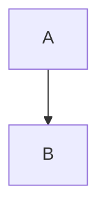

# 概要

[設計](SPECS/design.md#architecture)へのリンク。
[同一ファイル内章2](#section-2)へのリンク。

# アーキテクチャ

## 新しい言語の追加

言語追加手順。



## 1\/2. 概要\/構成

スラッシュ含む見出し。

```go
func Duplicate() {
}
```

```go
func Duplicate2() {
}
```

- リスト内のインデントされたコードブロック:
    ```go
    func IndentedInList() {
    }
    ```

# 重複見出し

## 概要

重複見出し1。

# 別の親

## 概要

重複見出し2。

# Section 2

章2の内容。
